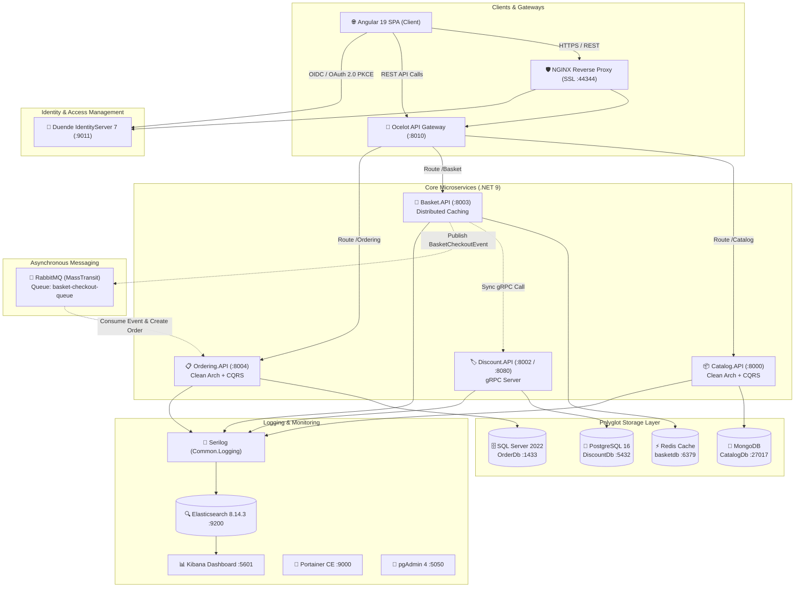

# 🛒 E-Commerce Microservices Platform

[](https://dotnet.microsoft.com/)
[](https://angular.dev/)
[](https://www.docker.com/)
[](https://www.rabbitmq.com/)
[](https://grpc.io/)
[](https://www.elastic.co/)
[](https://www.elastic.co/kibana)
[](https://duendesoftware.com/)
[](LICENSE)

> A modern, resilient, enterprise-grade **E-Commerce Distributed System** built with **ASP.NET Core 9**, **Angular 19**, **Clean Architecture**, **CQRS (MediatR)**, and **Event-Driven Architecture** orchestrated with **Docker Compose**.

---

## 📑 Table of Contents

- [Architectural Overview](#-architectural-overview)
- [System Architecture Diagram](#-system-architecture-diagram)
- [Microservices & Components Breakdown](#-microservices--components-breakdown)
- [Communication & Design Patterns](#-communication--design-patterns)
- [Observability & Monitoring](#-observability--monitoring)
- [Frontend Application (Angular 19)](#-frontend-application-angular-19)
- [Service URLs & Default Credentials](#-service-urls--default-credentials)
- [Directory Structure](#-directory-structure)
- [Getting Started](#-getting-started)
  - [Prerequisites](#prerequisites)
  - [Running with Docker Compose](#running-with-docker-compose)
  - [Running the Angular Frontend](#running-the-angular-frontend)
- [Database Migrations & Seeding](#-database-migrations--seeding)
- [Author & Acknowledgments](#-author--acknowledgments)

---

## 🏛 Architectural Overview

This solution adopts an **Event-Driven Microservices Architecture** adhering to **Clean Architecture** principles and **Domain-Driven Design (DDD)** concepts:

- **Polyglot Persistence**: Selecting the right database for the specific workload:
  - **MongoDB** for flexible, schemaless product catalog data.
  - **Redis** for lightning-fast distributed caching of shopping cart sessions.
  - **PostgreSQL** for relational coupon and discount persistence.
  - **Microsoft SQL Server** for transactional consistency and order processing.
- **Asynchronous Event-Driven Messaging**: Inter-service decoupling through **RabbitMQ** and **MassTransit**, supporting checkout events and decoupled order creation.
- **High-Performance Synchronous Communication**: Internal microservice-to-microservice communication (Basket ➔ Discount) powered by **gRPC** for low latency and high throughput.
- **Centralized API Gateway**: **Ocelot** acts as the single unified reverse proxy / gateway for client traffic, handling request aggregation, downstream routing, and file-based response caching.
- **Enterprise Security & Identity**: **Duende IdentityServer 7** supporting OAuth 2.0 & OpenID Connect (OIDC) with Authorization Code Flow + PKCE for SPA clients and Client Credentials for M2M communication.
- **SSL Termination & Reverse Proxy**: **Nginx** handles TLS termination, secure HTTPS traffic forwarding, and reverse proxy routing.
- **Distributed Logging & Observability**: Centralized structured logging with **Serilog**, streaming directly to an **Elasticsearch** cluster and visualized in **Kibana**.

---

## 📐 System Architecture Diagram



---

## 🧩 Microservices & Components Breakdown

| Service / Container | Technology / Framework | Port (Host:Container) | Database / Storage | Key Responsibilities & Highlights |
| :--- | :--- | :--- | :--- | :--- |
| **Catalog.API** | .NET 9.0, Web API | `8000:8000` | MongoDB (`27017`) | Manages products, categories, and brands. CQRS with MediatR, pagination, search, brand & type filtering, Swagger documentation. |
| **Basket.API** | .NET 9.0, Web API | `8003:8001` | Redis (`6379`) | Cart lifecycle management (add, update, delete). gRPC client consuming Discount service, MassTransit event publishing upon checkout. |
| **Discount.API** | .NET 9.0, gRPC + Web API | `8002:8080` | PostgreSQL 16 (`5432`) | High-speed discount and coupon evaluation engine exposed via gRPC Protobuf contracts (`DiscountProtoService`). Automatic DB migration. |
| **Ordering.API** | .NET 9.0, Web API | `8004:8080` | MS SQL Server 2022 (`1433`) | Complete order management lifecycle. Clean Architecture, CQRS with MediatR, EF Core Code-First, MassTransit RabbitMQ Consumer for automated order intake on checkout. |
| **eShop.Identity** | .NET 8.0, Duende IdentityServer 7 | `9011:9011` | In-Memory / Config | Centralized OAuth 2.0 & OpenID Connect authority. Token issuance, claims management, interactive login UI, PKCE support for Angular SPA. |
| **Ocelot.APIGateway** | .NET 9.0, Ocelot Gateway | `8010:8080` | File-based cache | Unified API entry point, route aggregation, microservice abstraction, upstream-to-downstream routing, response caching. |
| **Reverse Proxy** | Nginx Alpine | `44344:443` | N/A | SSL/TLS Termination, reverse proxy routing to IdentityServer and downstream microservices with secure forward headers. |
| **Client SPA** | Angular 19, TypeScript, Bootstrap | `4200:4200` (Local) | Local Storage / Session | Modern e-commerce web application: product catalog, dynamic filtering, shopping cart, checkout flow, order history, OIDC authentication. |

---

## 🔄 Communication & Design Patterns

### 1. CQRS & Clean Architecture
Each core microservice is structured following Clean Architecture layers:
- **Core / Domain**: Domain entities, specifications, and business rules.
- **Application**: Commands, Queries, Handlers (MediatR), Behaviors (Validation, Logging), DTOs, and AutoMapper profiles.
- **Infrastructure**: Data access implementations (EF Core, Dapper, Mongo driver), database contexts, and external service clients.
- **API / Presentation**: Controllers, middleware, dependency injection configuration, and Swagger/OpenAPI setup.

### 2. Synchronous Communication: gRPC
When a user adds items to the cart in `Basket.API`, it makes an ultrafast, typed **gRPC** call to `Discount.API` using generated Protobuf contracts to fetch applicable coupons and calculate live totals:
```protobuf
syntax = "proto3";
option csharp_namespace = "Discount.Grpc.Protos";

service DiscountProtoService {
    rpc GetDiscount (GetDiscountRequest) returns (CouponModel);
    rpc CreateDiscount (CreateDiscountRequest) returns (CouponModel);
    rpc UpdateDiscount (UpdateDiscountRequest) returns (CouponModel);
    rpc DeleteDiscount (DeleteDiscountRequest) returns (DeleteDiscountResponse);
}
```

### 3. Asynchronous Communication: Event-Driven with RabbitMQ
When checkout is triggered:
1. `Basket.API` handles `CheckoutBasketCommand`.
2. Creates and publishes a `BasketCheckoutEvent` to RabbitMQ via MassTransit.
3. Clears the user's shopping basket from Redis.
4. `Ordering.API` runs a background `BasketOrderingConsumer` listening to `BasketBusConstant.BasketCheckoutQueue`.
5. It handles the event, executes `CreateOrderCommand`, and persists the order to SQL Server.

---

## 📊 Observability & Monitoring

All microservices integrate `Common.Logging`, providing a unified logging pipeline:
- **Serilog**: Captures structured logs enriched with `ApplicationName`, `EnvironmentName`, and exception details.
- **Elasticsearch**: Ingests logs into time-series indices (`newecommerce-logs-yyyy.MM.dd`).
- **Kibana**: Interactive dashboards, real-time log streaming, and error search.
- **Portainer CE**: Web UI to monitor and manage Docker containers, resource consumption, and container logs.
- **pgAdmin 4**: Web management dashboard for the PostgreSQL database.

---

## 💻 Frontend Application (Angular 19)

The client is a standalone Single Page Application (SPA) built with **Angular 19**:
- **Store / Catalog Module**: Product listing with server-side pagination, keyword search, brand filtering, type filtering, sorting by price/name, and detailed product view.
- **Basket Module**: Reactive cart state, quantity adjustment, discount calculations, item removal.
- **Wishlist Module**: Save favorite products for future review.
- **Checkout Module**: Multi-step checkout wizard (address, delivery method, payment review).
- **Orders Module**: Historical orders view and order details tracking.
- **Account & Identity**: OIDC integration via `oidc-client-ts` / `oidc-client`, seamless redirect login/logout with IdentityServer.
- **Core UI Elements**: `ngx-spinner` for loading state, `xng-breadcrumb` for breadcrumb navigation, Toastr notifications, and responsive Bootstrap 5 styling.

---

## 🌐 Service URLs & Default Credentials

| Component | URL | Credentials / Notes |
| :--- | :--- | :--- |
| **Angular Client SPA** | [http://localhost:4200](http://localhost:4200) | Web Application UI |
| **Ocelot API Gateway** | [http://localhost:8010](http://localhost:8010) | Gateway Base URL |
| **Nginx Reverse Proxy** | [https://localhost:44344](https://localhost:44344) | HTTPS Reverse Proxy |
| **IdentityServer UI** | [http://localhost:9011](http://localhost:9011) | Test Users: `alice` / `alice` or `bob` / `bob` |
| **Catalog API (Swagger)** | [http://localhost:8000/swagger](http://localhost:8000/swagger) | Catalog API Documentation |
| **Basket API (Swagger)** | [http://localhost:8003/swagger](http://localhost:8003/swagger) | Basket API Documentation |
| **Ordering API (Swagger)** | [http://localhost:8004/swagger](http://localhost:8004/swagger) | Ordering API Documentation |
| **Kibana Log Visualizer** | [http://localhost:5601](http://localhost:5601) | Elasticsearch Log Viewer |
| **RabbitMQ Management** | [http://localhost:15672](http://localhost:15672) | Username: `guest` \| Password: `guest` |
| **Portainer CE** | [http://localhost:9000](http://localhost:9000) | Initial setup on first launch |
| **pgAdmin 4** | [http://localhost:5050](http://localhost:5050) | Email: `admin@ecommerce.com` \| Pass: `Password@1` |

---

## 📁 Directory Structure

```text
Ecommerce-Microservice/
│
├── package.json                          # Root package scripts
├── vercel.json                           # Vercel deployment configuration
├── README.md                             # Repository documentation
│
└── Ecommerce/                            # Core Solution Root
    ├── Ecommerce.sln                     # Visual Studio Solution
    ├── docker-compose.yml                # Production / Full Docker Compose orchestration
    ├── docker-compose.override.yml       # Local development overrides
    │
    ├── APIGateway/
    │   ├── Ocelot.APIGateway/            # Ocelot API Gateway (.NET 9)
    │   └── nginx/                        # Nginx reverse proxy configuration & certificates
    │
    ├── Infrastructure/
    │   ├── Common.Logging/               # Centralized Serilog & Elasticsearch configuration
    │   ├── eShop.Identity/               # Duende IdentityServer 7 (.NET 8)
    │   └── EventBus.Messages/            # MassTransit shared integration events & contracts
    │
    ├── services/
    │   ├── catalog/                      # Catalog Microservice (MongoDB + CQRS)
    │   │   ├── Catalog.API/
    │   │   ├── Catalog.Application/
    │   │   ├── Catalog.Core/
    │   │   └── Catalog.Infrastructure/
    │   │
    │   ├── basket/                       # Basket Microservice (Redis + gRPC Client + MassTransit)
    │   │   ├── Basket.API/
    │   │   ├── Basket.Application/
    │   │   ├── Basket.Core/
    │   │   └── Basket.Infrastructure/
    │   │
    │   ├── Discount/                     # Discount Microservice (PostgreSQL + gRPC Service)
    │   │   ├── Discount.API/
    │   │   ├── Discount.Application/
    │   │   ├── Discount.Core/
    │   │   └── Discount.Infrastructure/
    │   │
    │   └── Ordering/                     # Ordering Microservice (SQL Server + CQRS + Event Consumer)
    │       ├── Ordering.API/
    │       ├── Ordering.Application/
    │       ├── Ordering.Core/
    │       └── Ordering.Infrastructure/
    │
    └── client/                           # Angular 19 SPA Frontend
        ├── src/
        │   ├── account/                  # Authentication & OIDC Callback components
        │   ├── basket/                   # Shopping Cart components & services
        │   ├── checkout/                 # Checkout flow components
        │   ├── orders/                   # Customer order management
        │   ├── store/                    # Product catalog, details, & filters
        │   ├── wishlist/                 # Wishlist management
        │   └── core/                     # Navbars, interceptors, error handling
        └── package.json
```

---

## 🚀 Getting Started

### Prerequisites

Ensure you have the following installed locally:
- [Docker Desktop](https://www.docker.com/products/docker-desktop/) (with Linux Containers enabled)
- [.NET 9.0 SDK](https://dotnet.microsoft.com/download/dotnet/9.0) *(optional, for local debugging)*
- [.NET 8.0 SDK](https://dotnet.microsoft.com/download/dotnet/8.0) *(optional, for IdentityServer local debugging)*
- [Node.js (v18 or v20 LTS)](https://nodejs.org/) & [Angular CLI](https://angular.dev/tools/cli) *(for frontend)*

---

### Running with Docker Compose

1. **Clone the repository:**
   ```bash
   git clone https://github.com/AhmedMohamed12711/Ecommerce-Microservice.git
   cd Ecommerce-Microservice/Ecommerce
   ```

2. **Start all services, databases, and infrastructure tools:**
   ```bash
   docker compose up --build -d
   ```

3. **Verify running containers:**
   ```bash
   docker compose ps
   ```
   All microservices (`catalog.api`, `basket.api`, `discount.api`, `ordering.api`, `ocelot.apigateway`, `identityserver`), databases (`CatalogDb`, `basketdb`, `discountdb`, `orderdb`), messaging (`rabbitmq`), and observability (`elasticsearch`, `kibana`, `pgadmin`, `portainer`, `reverseproxy`) will spin up automatically.

4. **Shut down all containers:**
   ```bash
   docker compose down
   ```

---

### Running the Angular Frontend

1. Navigate to the client directory:
   ```bash
   cd Ecommerce/client
   ```

2. Install dependencies:
   ```bash
   npm install
   ```

3. Launch the development server:
   ```bash
   npm start
   # or
   ng serve
   ```

4. Open your browser and navigate to:
   ```text
   http://localhost:4200
   ```

---

## 🗄️ Database Migrations & Seeding

The microservices are designed with **zero-friction initial setup**:
- **MongoDB (Catalog)**: Automatically seeds initial catalog products, brands, and categories on first launch if empty (`CatalogContextSeed`).
- **PostgreSQL (Discount)**: Automatically runs SQL DDL scripts and inserts initial coupons on application bootstrap (`MigrationDatabase<Program>()`).
- **SQL Server (Ordering)**: Automatically applies Entity Framework Core migrations and runs `OrderContextSeed` on startup (`Migratedatabase<OrderContext>()`).

---

## 👨‍💻 Author & Acknowledgments

- **Developed by**: [Ahmed Mohamed](https://github.com/AhmedMohamed12711)
- **Contact**: [ahmedmohamed00521@gmail.com](mailto:ahmedmohamed00521@gmail.com)

---

## 📄 License

This project is licensed under the [MIT License](LICENSE) - feel free to use it for learning, research, and building microservice architectures.
